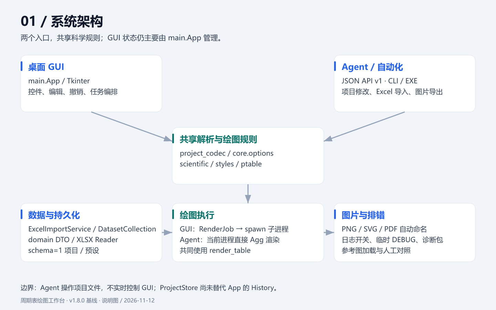
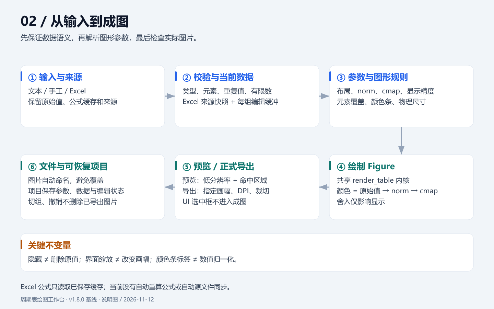
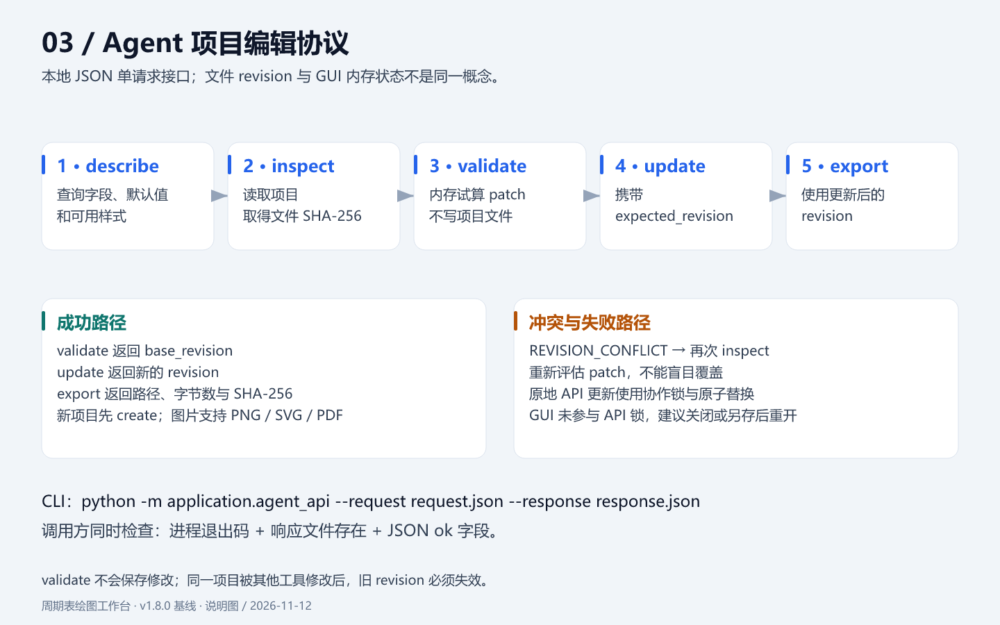
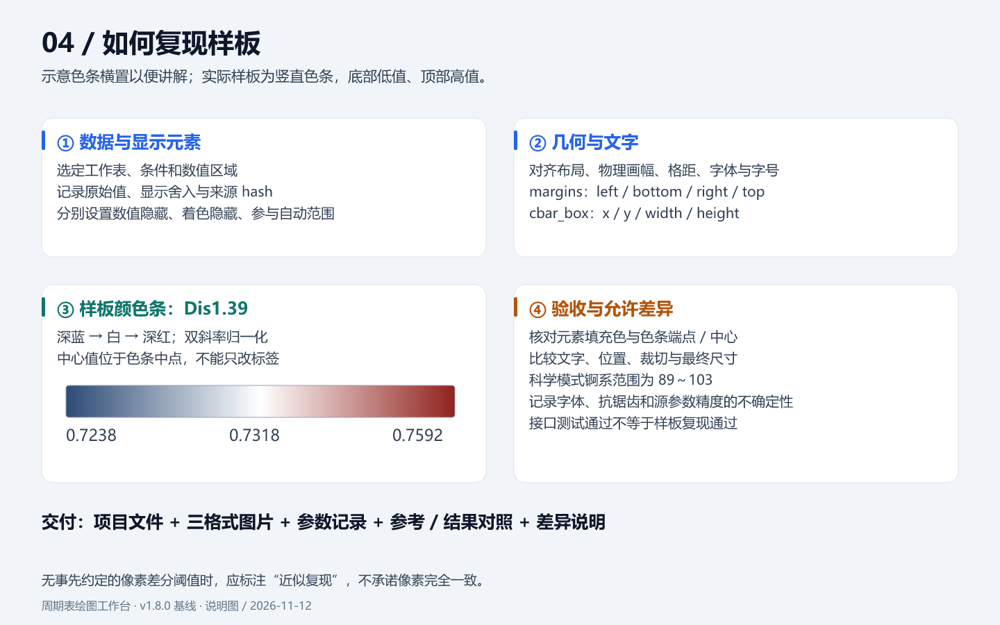
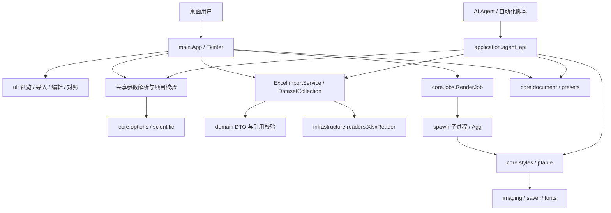
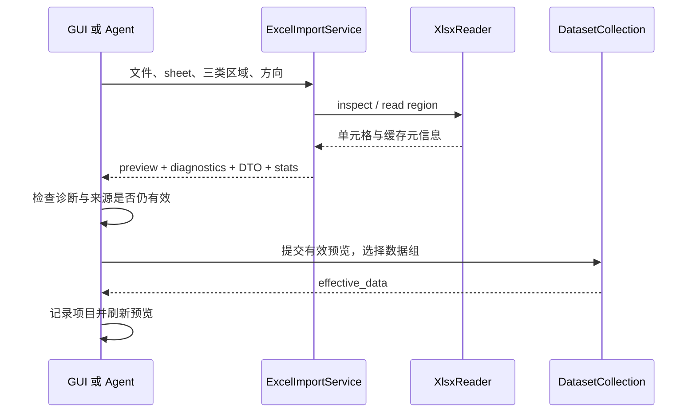

# 周期表绘图工作台：架构与工程交接

> 基线：v1.8.0，提交 `a1d79f2d7e127af1ef86efe827f8d8c97c20e2c4`；核对日期：2026-11-08。本文依据当前源码描述已实现行为。交接文档自身的新增不属于该基线提交。
>
> 阅读顺序：本文 → [运维、排错与发行交接](HANDOFF-OPERATIONS.md) → [用户及 Agent 使用说明](../README.md) → 对应模块测试。

## v1.9.0 增量（2026-11-13）

Agent 新增无状态 `render` 与同指标 Excel 数据组 `batch_export`（最多 100 组）；`describe` 增加 `parameter_options/action_required_fields/action_metadata`，`REVISION_CONFLICT.details` 返回预期/当前 revision 与恢复提示。API 仍为 v1，项目仍为 schema=1；具体契约见 [Agent 高效绘图流程](AGENT-WORKFLOWS.md)。

`core/layout_diagnostics.py` 基于渲染后的文字包围盒诊断元素标注，GUI 预览与 Agent 导出使用该能力；`display.check_label_overlap=true` 默认开启，结果通过 `layout_issues` 与 warnings 提示，不自动修改数据或排版。`display.preserve_cbar_space=false` 默认关闭，开启后隐藏颜色条可保留主图区位置，对照图应配合固定画幅。

以下各节保留 v1.8.0 架构基线，以上为 v1.9.0 增量。v1.9.0 EXE 已完成构建及新功能验收，见 [本版验证记录](RELEASE-v1.9.0.md)；旧版 EXE 需更新。

## 1. 产品目标与边界

配套图解：[说明图索引与可编辑 SVG](diagrams/README.md)。









这是面向元素数据的 Windows 桌面科学绘图工具。输入元素数值、文本标注或 Excel 矩阵，编辑周期表布局、归一化、配色、颜色条和标注，保存可恢复项目并导出 PNG/SVG/PDF。Windows EXE 内置运行环境；Python 源码入口适合开发和 Agent 调用。

核心质量要求：原始数值不因显示精度而改变；隐藏不等于删除；不同图之间可以固定共用色标；导出不覆盖已有图片；历史脚本复现与修正后的科学绘图有明确区分。

当前不是通用图表平台，不自动从参考图识别样式，不计算 Excel 公式，不提供网络 API，不提供 Agent 对正在运行 GUI 的实时控制。

### 1.1 当前与规划的分界

| 能力/结构 | v1.8.0 实际状态 |
|---|---|
| 14 个样式入口 | 13 个历史脚本模式加自定义入口；其中含色图预览，不应解释成 14 种相同类型热图 |
| 修正/兼容绘图 | 已实现，修改规则应进入科学策略与共享参数解析层 |
| Excel 横/纵矩阵导入、多组保留和切换 | 已实现；同指标多组可共用当前色标导出 |
| 项目格式 | **schema=1**，扩展包含 Excel 集合；不是全新 schema=2 项目 |
| GUI 主控制器 | `main.App`，仍承担大量编排和历史记录职责 |
| `application.state.ProjectStore` | 已有事务状态基础设施及测试；**当前 App 的撤销仍使用 `core.document.History`** |
| 字段级 Override、统一命令总线、完整端口层 | 旧工作台设计包含这些目标；不能按全部已接入理解 |
| Excel 编辑覆盖 | 当前为每个 dataset 的完整编辑缓冲 `manual_data`，不是规划中的逐字段 Override 实体 |
| Agent | API v1、本地 JSON 单请求；源码与 EXE 可调用 |

`docs/workbench/` 保留产品规格、架构目标、契约和排期。它们解释设计意图，但部分仍是规划。维护者遇到不一致时先核对源码、测试和本文基线，再修改契约；不能因旧契约提到 schema=2 就把当前文件当 schema=2 读取。

## 2. 系统结构与依赖



这是当前调用关系，不是严格的依赖倒置架构。`application.project_codec` 会依赖 Matplotlib 风格解析；`main.py` 同时引用应用层和核心层。不要把“目录分层”误认为控制器已经完成解耦。

### 2.1 模块责任索引

| 路径 | 职责及维护入口 |
|---|---|
| `main.py` | 程序入口、`App`、数据表、菜单、Tk 变量、草稿、历史、异步任务、导入导出、预设与颜色条编辑编排 |
| `ui/preview.py` | `PreviewCanvas`，图片展示、缩放平移、元素命中、选中框、拖动反馈；不计算科学数值 |
| `ui/edit_controls.py` | `EditControlsMixin`，单元素设置、精确尺寸、拖动结果应用、参考窗口入口 |
| `ui/import_wizard.py` | Excel 工作表/区域选择和预览，确认后由调用方提交 |
| `ui/reference_view.py` | 样图与当前快照对照，独立视图及手动刷新 |
| `ui/scrolling.py`, `ui/workspace.py` | 可滚动控件与工作区支持 |
| `application/project_codec.py` | 默认 payload、完整校验、从项目解析渲染 style；无 Tk 依赖 |
| `application/agent_api.py` | 版本化请求、patch、文件指纹、写入保护、导出、统一响应 |
| `application/excel_import.py` | 读取协调、显式区域映射、诊断、生成预览 DTO；只读，不直接提交 GUI |
| `application/dataset_collection.py` | 导入集合、引用完整性、当前组、每组编辑缓冲和快照 |
| `application/batch_datasets.py` | 从集合规划批量数据、同指标约束、组范围和名称 |
| `application/state.py` | 独立事务状态容器，隔离快照、撤销重做、脏标记和订阅通知 |
| `domain/` | `CellRef/CellValue/ElementRecord/Provenance/Dataset/ImportMapping/Diagnostic` 及纯契约校验 |
| `infrastructure/readers/xlsx_reader.py` | ZIP/XML XLSX 读取、工作表摘要、区域读取、公式缓存和资源预算 |
| `infrastructure/diagnostics/` | 日志设置、事件写入、脱敏、诊断包 |
| `core/styles.py` | `STYLES`、色图/归一化/格式化和 `render_table`；主要绘图内核 |
| `core/scientific.py` | 修正策略、色条配置、元素覆盖、范围警告与参数约束 |
| `core/options.py` | 中文选项映射、字符串参数转换、毫米画幅和 Figure 区域解析 |
| `core/ptable.py`, `elements_data.py` | 布局坐标、元素集合、命中几何基准；不依赖外部元素数据库 |
| `core/jobs.py` | 常驻 spawn 绘图进程、请求合并、失效结果屏蔽、取消与暂存 |
| `core/imaging.py` | Figure 栅格化、命中图转换、统一保存选项 |
| `core/fonts.py` | 字体 fallback；不同机器字体仍可能影响版面 |
| `core/document.py` | schema=1 读写、用户目录、原子持久化和 GUI History |
| `core/presets.py` | 预设持久化 |
| `core/saver.py` | 原子占用输出名、时间戳和冲突序号、失败占位清理 |
| `core/reference_image.py` | 参考图读取、SVG 自包含校验及资源预算 |
| `build_exe.py`, `make_dist.py`, `verify_exe.py` | EXE 构建、源码包、冻结程序验收 |

## 3. 数据契约与状态所有权

### 3.1 项目文档

`.ptproj` 是 UTF-8 JSON；不能写入 Tk 对象、Figure、PIL 图像、进程句柄或 Python 表达式。

```json
{
  "schema": 1,
  "current": {
    "mode_id": "custom",
    "compatibility": false,
    "params": {},
    "display": {},
    "data": {},
    "show_cbar": true,
    "show_cbar_labels": true,
    "cbar_override": null,
    "custom_colors": [],
    "element_overrides": {},
    "output_format": "svg",
    "output_dir": ""
  },
  "styles": {},
  "excel_collection": {
    "datasets": [], "conditions": [], "metrics": [],
    "sources": [], "mappings": [],
    "active_dataset_id": null, "manual_data": {}
  },
  "excel_attached": false
}
```

这是**结构示意，不是可直接提交的完整请求**：真实默认值请取 `default_payload()` 或 Agent `describe`。`custom_colors` 必须使用合法颜色；不要照抄空数组覆盖默认值。旧项目可没有 Excel 扩展字段，加载时构造空集合。

`current` 保存当前编辑 payload，`styles` 保存切换样式时的状态。二者必须分别验证。`params` 为 UI 友好的字符串，例如 `dpi="300"`、`figsize="254x127 mm"`；`display` 是布尔值；`data` 保留原始数值或文本。`resolve_payload()` 生成经过转换的 style，不能用 style 反写覆盖原始 data。

项目边界分两层：`core.document.read_document` 做格式与容器基础检查，`project_codec.validate_payload` 和 `DatasetCollection.from_snapshot` 做业务校验。不要把“JSON 能解析”视为项目有效。

### 3.2 Excel 领域对象与来源

`CellValue.kind` 区分 `number/text/missing/error`；`numeric` 与 `raw_text` 分离，`formula/cached/format_code/source` 保存来源信息。零是有效数字；空值不是零。`CellRef` 定位 source、sheet 和 A1 单元格。公式只读取文件已保存结果，不能承诺缓存已刷新。

`Dataset` 通过 metric_id、condition_id 关联指标与条件；records 按规范元素符号索引。`Provenance` 带映射 ID、来源 hash、转换版本和时间。集合加载会校验 ID 唯一性、引用、来源 hash、value kind；错误单元格不能进入成功提交的数据集。

`DatasetCollection.manual_data[dataset_id]` 是**整组有效编辑缓冲**，可以保留“删除某元素”的用户操作。切组前必须 stash 当前编辑，切组后读取 effective_data；不能直接覆盖来源 DTO。项目带来源快照，所以没有原 Excel 也能恢复已经导入的数据；来源 locator 只是定位信息，不代表自动同步。

### 3.3 三种不同的版本信息

| 名称 | 含义 | 不应混用 |
|---|---|---|
| 文档 `schema=1` | 磁盘格式版本 | 不代表应用或 API 版本 |
| Agent `revision` | 原始项目文件字节 SHA-256 | 不是 GUI 计数器；只改 JSON 缩进也会改变 |
| `ProjectStore.revision` | 内存事务递增整数 | 当前 GUI History 并不以它作为项目文件锁 |

API 的 `validate` 返回 `base_revision`，表示试算基于哪个文件；没有修改文件，不会产生新的可写 revision。

### 3.4 状态与历史

GUI 主线程拥有 Tk 变量、当前数据和 `History`。`App._document_snapshot()` 打包 current/styles/Excel 状态；恢复文档时应先完整验证，再替换当前状态。失败不得留下半个新项目。

`ProjectStore` 用 JSON 编码隔离快照，validator 不能偷偷改变提交文档；事务失败不推进历史。订阅者失败记录 observer_errors，不回滚已经提交的事务。后续若迁移 GUI 到 Store，要同时迁移 dirty、草稿、撤销与切组，不能长期维护两套并行真相。

图片是已经发布的外部产物，不属于撤销范围。撤销标注不会删除此前导出图片。

## 4. 关键业务流程

### 4.1 手工数据与标注修改

文本/文件 → `parse_data`（需要时保留字面值）→ `convert_data` 按图形类型解释 → 校验 → 更新当前数据 → 同步所属 Excel 编辑缓冲 → 记录文档变更 → 请求预览。

热力图只接受有限数字；文本标注保留 `001/1.00/1e3` 等字面格式。重复元素应在输入阶段报错，不能被字典覆盖。GUI 图形标注默认启用；点击选元素，回车应用，Esc 取消输入，Ctrl+Z 撤销。输入框不是另一份正式数据源。

### 4.2 Excel 导入与切组



GUI 由导入对话框确认；Agent 的 import_excel 直接执行显式请求。当前主要支持 matrix_rows / matrix_columns。不要根据“任意 Excel”宣传自动识别复杂合并表头、分类长表或源文件监控。

### 4.3 预览与导出

GUI 先解析参数和 data，再生成纯数据请求。`RenderJob.start` 序列化快照发送到 spawn 子进程，子进程采用 Agg，不创建 Tk 或交互式 Figure 窗口。主进程从单一线程轮询消息。

运行中新的预览只保留最后一个待执行请求，并把当前结果标为过期；`invalidate` 屏蔽旧结果，避免用户已修改参数却看到晚到的旧图。`cancel` 会停止进程并清理私有暂存树。不能用后台进程直接修改 GUI。

预览限制 DPI 和最长栅格边（当前上限逻辑为 DPI 不超过 100、长边约 1600 像素），不改物理构图；正式导出使用指定 DPI。预览返回 PNG 字节、命中几何与实际颜色条 box。

GUI 批量导出先在私有目录完成，再由控制器发布；RenderJob 返回的临时文件在下一次调度/取消后可能失效，应及时处理。API export 在调用进程中直接使用同一内核，**不走 GUI 的 RenderJob**，失败时清理本次已创建产物。两个入口共享绘图规则，不共享任务调度。

### 4.4 图形拖动

PreviewCanvas 把屏幕坐标映射到图像/命中区域；选择轮廓和虚线目标属于 UI 覆盖层，不写入导出。左拖元素经 `on_move(symbol,dx,dy)` 更新元素位置；颜色条经 `on_colorbar_move(x,y)` 写 Figure 坐标。右拖只是平移视图。

单次释放后提交修改并重新渲染，禁用或预览过期时取消拖动。固定画幅支持颜色条拖动；紧裁切后的像素原点和 Figure 原点不同，不能直接套用同一换算。

### 4.5 样式预设

默认保存/加载样式，不替换当前数据、Excel 组和输出位置。用户显式包含数据时才恢复预设数据，并解除旧 Excel 组关联。测试时必须检查“样式加载成功，但数据是否被意外替换”。

## 5. 科学绘图规则：必须保留的自由度

### 5.1 历史兼容与修正规则

`STYLES` 是历史规则基线。`corrected_style` 深拷贝并设置修正策略，不允许原地污染。兼容模式要保留原始脚本的历史行为；科学模式修正锕系 89～103、有效零值和舍入等问题。新增需求应在可配置策略中实现，避免统一修改破坏 13 个历史输出基准。

`core.options.apply_custom_params` 是 GUI 与 Agent 共用的参数转换函数；`project_codec` 负责纯项目解析。GUI 不是简单调用整个 Codec，但两者使用共享转换规则，测试覆盖全部样式在两种模式下的一致性。`ui/edit_controls.py` 仍有尺寸解析入口，后续去重应带 GUI 回归。

### 5.2 颜色映射不等于颜色条标签

颜色由数值 → norm → cmap 决定；颜色条 ticks/labels 只决定标注位置和文字。把标签改成样板的数值，**不会自动改变元素着色或白色中心位置**。

- vmin/vcenter/vmax 定义双斜率归一化；不对称范围可以让中心值位于色条中点。
- 自定义 RGB 序列的通道使用 0～1；`color_nodes` 可定义显式位置，端点必须为 0 和 1。
- `show_cbar` 控制色条，`show_cbar_labels` 控制标签。
- `cbar_override` 为 `{ticks,labels,visible,fontsize}`，三个列表等长，ticks 有限且不重复。
- `colorbar_config` 校验全部行，排序并过滤不可见行；隐藏配置仍存在 document 中，resolved_style 中只包含可见刻度。
- 颜色条 orientation/location/fraction/pad/shrink 与显式 cbar_box 均可设置。

复现参考图要逐项核对范围、中心、色图端点/节点、刻度、字体、尺寸、位置和裁切。以本次 Dis1.39 样板为例，刻度是 0.7238/0.7318/0.7592，不能用测试用的“低/高”替代。SVG 本身不一定包含原始 norm 的全部精度，无法确认时必须标明近似复现。

### 5.3 单元素覆盖

```json
{"Cu":{"show_value":false,"show_color":true,"include_in_range":false,"value_dx":0.05,"value_dy":0.02}}
```

`show_value` 控制数值标注，`show_color` 控制数据着色，`include_in_range` 控制自动范围；它们互相独立，不删除 data。位置偏移为绘图数据坐标，不是屏幕像素。单元素配置必须经 validate_element_overrides 校验，不能接受未知元素或任意 style 字段。

### 5.4 精度、画幅与文字

科学模式 Decimal half-up 只影响显示，如 0.73925 → 0.7393；原始 data 保留。兼容浮点舍入用于历史复现。

`figsize` 可用英寸（默认）或毫米；PNG 像素约等于英寸×DPI。`margins=[left,bottom,right,top]` 是边界，而 `cbar_box=[x,y,width,height]` 是位置和尺寸，两者均为 Figure 归一化坐标、左下角原点。不是同一种四元组。

固定画幅保持指定最终尺寸；紧裁切会改变最终尺寸。GUI 窗口/字体缩放与预览 zoom 不应改变导出物理构图。

SVG 默认文字可转为路径，颜色条可能内嵌栅格渐变；“导出 SVG”不等于所有对象均为可编辑文本或纯矢量。字体可用性、Matplotlib 版本会影响视觉一致性，应记录环境而不是承诺跨环境像素完全相同。

## 6. Agent 接口契约与扩展点

### 6.1 入口

```powershell
python -m application.agent_api --request request.json --response response.json
```

EXE 使用 `--agent-request`、`--agent-response`。`main.py` 在导入 tkinter 前分流；冻结窗口版使用响应文件读取结果。纯 Python 可调用 `execute(request)`，但返回内容仍应按 JSON envelope 处理。

请求公共字段：api_version=1、action、可选 request_id。成功响应 `ok=true/result`，失败响应 `ok=false/error.code/message`，部分错误有 details。常规 API 失败退出码 2，成功为 0；启动失败或输出文件 I/O 故障不能保证一定形成完整 JSON，调用方还要检查进程和响应文件。

| action | 作用 | 文件副作用/并发 |
|---|---|---|
| describe | 能力、默认值、样式、参数选项、patch 字段 | 不写项目 |
| create | 新建项目 | 目标已存在拒绝 |
| inspect | 文档、style、警告、revision | 不写项目 |
| validate | 内存应用 patch 后试算 | 不写项目；返回 base_revision |
| update | 修改或另存项目，支持 dataset_id | 必须 expected_revision |
| excel_preview | 列 sheet 或区域预览 | 只读工作簿 |
| import_excel | 导入全部组并选择一个组 | 必须 expected_revision，可另存 |
| export | 自动命名导出多个格式 | 可传 revision；不改项目 |

`parameter_choices` 某些值为“中文显示值 → 内部值”的映射，某些为序列；Agent 应先 describe，不能假定全部为数组。

### 6.2 Patch 规则

顶层允许字段以 `PATCH_FIELDS` 为准；未知请求字段和 params/display 字段拒绝。params/display 浅合并；data 默认合并，元素值 null 删除；`replace_data=true` 必须显式提供 data，`data={}` 可清空。element_overrides 按元素合并，元素值 null 重置该元素覆盖。切换 mode_id 保存旧样式，并恢复目标样式状态/默认值，保留当前数据。

先 inspect → validate → 审核 document/resolved_style/warnings → update 使用最初 revision → 使用新 revision export。validate 不会替调用方保存修改。

### 6.3 并发与文件一致性

Agent 输入接受 UTF-8/BOM，拒绝重复 JSON 键及非有限数字，JSON 输入预算 64 MiB。创建/另存使用同目录临时文件加 hard link 的不覆盖发布；原地更新使用 `.agent-lock` 协作锁、写前 hash 复查和文档原子替换。

锁只保护遵守该协议的 API 写者。GUI 和外部编辑器没有共享锁，写前检查也不能消除非协作写者的全部竞态。操作同一项目时先保存并关闭 GUI，或 API 另存后在 GUI 重新打开。异常遗留锁的处理见运维文档；不能无条件删除活动写者的锁。

接口不是 HTTP 服务，没有认证会话或执行任意代码的 action。它具有调用用户的本地文件权限，属于可信本地工具，不是供不可信远程输入使用的隔离沙箱。不要暴露内网代理端口替代正式服务设计。

### 6.4 新增参数的完整修改路径

1. 明确存储字段、默认值、类型、单位与兼容模式语义。
2. 修改 options/科学校验与 project_codec 默认值；必要时扩展 API PATCH_FIELDS，不复制另一套解析。
3. 在 renderer 中实现行为，保证 Figure 关闭、输入不变。
4. 增加 GUI 控件、payload 恢复、历史记录、预览请求和预设支持。
5. 验证项目往返、GUI/Agent 一致、真实导出和异常输入；更新 describe、README 和交接文档。

新增 action 应先定义请求/响应、事务和失败清理，再添加 ACTIONS 分发表与 CLI 测试；不要把网络、任意 shell 或 eval 加入绘图 API。

## 7. 错误处理与排错分层

| 现象 | 优先检查 |
|---|---|
| 数据导不进 | Reader 预算、sheet/区域、方向、公式缓存、诊断定位和阻断错误 |
| 切组后值不对 | stash 是否执行、active_dataset_id、manual_data 和 effective_data |
| GUI 与 Agent 成图不同 | 同一 payload/compatibility、options 转换、字体环境、裁切和 DPI |
| 色条与样板不同 | norm/cmap 与 ticks 是否混淆、隐藏行、显式 box、源 SVG 可恢复精度 |
| 拖动跳位 | preview stale、屏幕到图像转换、tight crop、Figure 左下角原点 |
| 预览显示旧图 | 请求失效/sequence、pending 合并、控制器是否接受了 obsolete 结果 |
| 输出丢失或空文件 | RenderJob 暂存生命周期、发布路径、auto_name 占位清理、目录写权限 |
| Agent 修改被拒绝 | revision 是否来自当前文件、锁、目标是否已存在、未知字段 |
| 项目恢复失败 | schema、完整业务校验、Excel ID/引用、旧版本丢弃扩展字段 |

日志提供开关、级别、临时详细排错和诊断包；日志排错不应默认记录工作簿内容、原始单元格或完整项目。具体文件位置、设置和恢复步骤见 [运维交接](HANDOFF-OPERATIONS.md)。

## 8. 验证策略与交接证据

测试按修改影响面选择，不为纯文档变更重跑整个绘图套件。

| 风险 | 主要测试 |
|---|---|
| 历史输出被改变 | test_consistency、fixtures/originals、test_render_regressions |
| 科学参数与色标 | test_scientific_workflow、test_scale、test_cbar、test_render_edit_controls |
| 项目/共享解析 | test_project_codec、test_project_workflow、test_application_state |
| Excel 与数据组 | test_xlsx_reader、test_excel_import_service、test_dataset_collection、test_batch_datasets |
| UI 与拖动 | test_annotation_editing、test_preview_drag_controls、test_edit_controls_integration、test_ui_regressions |
| 子进程与产物 | test_render_jobs、test_saver、test_workflow_acceptance |
| 自动化入口 | test_agent_api、test_exe_verification、冻结 EXE 实际验收 |
| 样图与 SVG | test_reference_image；不把参考图加载等同自动仿制 |

v1.8.0 发行前记录为 717 tests passed、13 subtests passed；这是已有基线，不表示本文编辑后重新跑过。EXE 验收包含 6 次真实 Agent 命令、过期写拒绝及三格式导出。测试环境警告、日志和精确命令见运维交接。

桌面 dsh 独立测试另执行 13 次请求（8 次成功、5 次预期拒绝），用主图/对照图检查配色、刻度隐藏与 Cu 数值隐藏；在其覆盖范围内未发现功能缺陷。该轮使用源码副本和合成数据，未覆盖 Excel action 或冻结 EXE，不能替代其验收。

真实 Excel 和 Dis1.39 SVG 仿制产物位于本机 `output/`；不包含在源码发行包。交接给其他机器时提供合成最小复现和操作说明，不依赖开发者桌面的私人绝对路径。参考图近似匹配与历史脚本像素一致是两种不同的验收标准。

## 9. 后续重构建议与实施顺序

以下是建议，不是当前完成项：

1. **先固定行为基线**：保存无私人数据的项目 golden fixture，记录 scientific/compatibility、字体与依赖版本；保留 Agent/GUI 对照。
2. **拆控制器用例**：依次提取项目打开保存、导入切组、导出编排。入口调用薄服务，服务不持有 Tk。避免一次重写 main.py。
3. **统一状态提交**：选择 ProjectStore 作为目标，逐个迁移命令和历史；桥接期间明确单一权威，迁完移除旧 History 路径。
4. **完善共享 Schema/描述**：以实际 Codec 为中心生成稳定参数描述，再考虑正式 JSON Schema；保证旧省略字段可加载、未知核心字段不会静默吞掉。
5. **改善 Agent 可诊断性**：冲突 details 返回 observed_revision；describe 明确选项结构；校验结果同时展示原始和可见刻度。返回 revision 不意味着可以自动强行重试旧 patch。
6. **提高编辑交付能力**：可选 SVG 文本保留、色条矢量策略；须评估字体替换和旧图差异，作为显式选项发布。
7. **再推进复杂 Excel**：长表/分类、映射保存、源更新均需先定义来源快照、冲突与覆盖语义，不能绕开 domain 校验。

不要借重构减少颜色节点、归一化、布局、字体、独立标注或精确画幅的可配置性。新增简化向导可以隐藏高级选项，但项目与接口仍应保留完整表达能力。

## 10. 子代理任务切分与验收模板

建议按不重叠写集分工，主管负责共享契约、渲染科学性和最终集成：

| 工作包 | 建议写集 | 最少验收 |
|---|---|---|
| 参数/渲染策略 | core.options、scientific、styles、相关测试 | 科学正确性、历史基线、输入不变 |
| GUI 编辑体验 | ui 与指定 main 方法 | 编辑/撤销/切组/预览与最终导出一致 |
| Excel 能力 | reader、excel_import、domain、集合测试 | 区域/公式/空值/来源/错误原子性 |
| Agent 与 Codec | agent_api、project_codec、接口测试 | 请求响应、版本冲突、失败无副作用、与 GUI 匹配 |
| 构建运维文档 | 构建脚本、验收脚本、文档 | 真 EXE、依赖收集、四附件校验 |

每个任务说明必须列出：基线提交、具体问题与复现、允许修改路径、不能破坏的不变量、接口变更、验收命令、生成物、未覆盖项。共享字段变更先由主管确认同名同义，再分发消费方。

完成报告应包含修改文件、行为变化、实际测试结果、失败/限制和产物路径。不得把“已写测试”表述成“测试通过”，不得把“describe 正常”表述成“成图与样板一致”。

## 11. 接手检查单

- [ ] 确认工作树、版本与依赖，保留用户未提交工作。
- [ ] 使用独立 PTT_USER_DIR，避免影响真实草稿/预设。
- [ ] 跑通合成数据首图和 schema=1 项目往返。
- [ ] 用 describe/inspect/validate/update/export 跑通 Agent 链路。
- [ ] 了解 scientific 与 compatibility 的不同基线。
- [ ] 了解 Excel 来源 DTO 和 manual_data 编辑缓冲的区别。
- [ ] 修改绘图后检查颜色、刻度、位置、精度、尺寸与裁切，不仅检查文件存在。
- [ ] 按影响范围运行测试；发版另做冻结 EXE 验收。
- [ ] 发布同时包含 EXE、Windows 包、源码包、SHA256SUMS，核对远端实际资产。
- [ ] 更新 README、版本说明和本文涉及的契约；规划未完成项保持显式标记。

## 12. 可运行的最小交接演练

以下 Python 示例从仓库根目录运行，使用全新的临时产物目录，不需要真实 Excel。保存为本地临时脚本，或逐段执行；它调用正式 API 执行函数，CLI/EXE 进程级检查仍须单独完成。

```python
import json
import tempfile
from pathlib import Path
from application.agent_api import execute

root = Path('output').resolve()
root.mkdir(exist_ok=True)
folder = Path(tempfile.mkdtemp(prefix='handoff-', dir=root))
project = folder / 'demo.ptproj'

def call(action, **fields):
    request = dict(api_version=1, action=action, **fields)
    response = execute(request)
    (folder / f'{action}-request.json').write_text(
        json.dumps(request, ensure_ascii=False, indent=2), encoding='utf-8')
    (folder / f'{action}-response.json').write_text(
        json.dumps(response, ensure_ascii=False, indent=2), encoding='utf-8')
    if not response['ok']:
        raise RuntimeError(response['error'])
    return response['result']

call('describe')
call('create', project=str(project), patch={
    'data': {'H': 0, 'Ni': 0.5, 'Cu': 0.73925},
    'params': {'vmin': '0', 'vcenter': '0.5', 'vmax': '1',
               'fmt': '四位小数', 'figsize': '254x127 mm', 'dpi': '150'}
})
original = call('inspect', project=str(project))
patch = {'element_overrides': {'Cu': {'show_value': False}},
         'cbar_override': {'ticks': [0, 0.5, 1],
                           'labels': ['0', '0.5', '1'],
                           'visible': [True, True, True], 'fontsize': 8}}
before = project.read_bytes()
trial = call('validate', project=str(project),
             expected_revision=original['revision'], patch=patch)
assert trial['dry_run'] and project.read_bytes() == before
updated = call('update', project=str(project),
               expected_revision=original['revision'], patch=patch)
result = call('export', project=str(project),
              expected_revision=updated['revision'],
              output_dir=str(folder), formats=['png', 'svg', 'pdf'])
assert len(result['files']) == 3
assert all(Path(item['path']).stat().st_size > 0 for item in result['files'])
stale = execute(dict(api_version=1, action='update', project=str(project),
                    expected_revision=original['revision'], patch={'data': {'Ni': 0.6}}))
assert not stale['ok'] and stale['error']['code'] == 'REVISION_CONFLICT'
print(folder)
```

预期：生成项目、请求/响应记录及三格式图片；Cu 保留颜色但不显示数值；旧 revision 修改失败。人工打开 PNG，检查 H=0 被显示、色条三刻度存在和 Cu 隐藏生效。文件非空只是基础检查，不足以证明图形正确。

将同一请求交给独立进程时，执行 `python -m application.agent_api --request 请求路径 --response 响应路径`；重新运行 create 应改用新项目路径。不要把本次执行产生的 SHA-256 硬编码为永久 revision。

## 13. 样板复现的专门验收协议

功能测试和样板复现分别记录结果。前者回答“参数是否生效”，后者回答“给定数据与参考图是否一致”。合成蓝白红测试通过不能替代真实样板比对。

### 13.1 开始前登记

| 项目 | 必填内容 |
|---|---|
| 参考来源 | 文件名、SHA-256、SVG viewBox/物理尺寸或栅格像素尺寸 |
| 数据来源 | 工作表、矩阵范围、条件标签、原始值与显示值、文件 SHA-256 |
| 元素集合 | 有数据元素、可见元素、隐藏数值/颜色/不参与范围的元素 |
| 颜色规则 | norm 类型、最小/中心/最大值、颜色节点、超范围策略 |
| 版式 | 经典/重构布局、字体、字号、画幅、裁切、边距、色条 box |
| 接受的差异 | 科学错误修正、源图舍入错误、字体替换、无法反推的原始参数 |

以 Dis1.39 为例：条件约 1.38889；数据源保留 32 个数值，其中样板显示 26 个，Ti/Ni/Mg/Al/Ga/Ge 的隐藏需要分别保留配置。颜色条刻度 0.7238/0.7318/0.7592；科学模式保留正确的 89～103。这些是本次样板的规则，不应成为所有项目的默认规则。

### 13.2 分层比对

1. **数据正确性**：核对源数据及 hash；显示舍入不写回数据；隐藏元素仍在项目中。
2. **语义正确性**：元素符号、原子序数、显示数值、标题、颜色条标签逐项比对。
3. **颜色正确性**：检查对应元素填充与色条端点/白色中心；不要只比较三个刻度文字。
4. **几何正确性**：统一物理比例后检查格子位置、格距、字体、颜色条长度/宽度和与主体距离。
5. **输出正确性**：确认 PNG 尺寸、SVG/PDF 物理尺寸、透明度、裁切及字体可用性。

栅格差分需统一分辨率、背景、颜色模式；不要为降低差异随意拉伸参考图。不同渲染器的抗锯齿差异应单独说明。阈值应在验收前约定，没有阈值时使用“近似复现”并列出差异，不声称像素一致。

推荐交付：原始数据摘要、项目文件、导出物、参考/结果并排图、差异说明、请求/响应记录和环境信息。私人数据只能保存在获授权的交接位置，不能混入公开 fixtures/examples。

## 14. 接口与文档演进规则

### 14.1 兼容性决策

| 变更 | 要求 |
|---|---|
| 新增可选字段 | 明确缺省语义；旧项目加载不改变旧图；往返测试验证 |
| 修改字段单位或含义 | 不能复用旧字段名静默解释；设计迁移或新版本 |
| 修改中文选项名称 | 评估现有 Agent 请求和项目；必要时提供旧值兼容映射 |
| 新增 API action | 更新 ACTIONS、describe、示例、文档和成功/失败用例 |
| 项目 schema 升级 | 独立迁移函数、备份/另存、旧 fixture、未知未来版本拒绝 |
| 修正历史绘图错误 | 默认科学模式实现；兼容模式基线应保持或明确发布破坏性变更 |

迁移不能依赖 GUI 自动点击，也不能运行项目中携带的代码。迁移失败保留原文件；成功后验证业务引用、重新打开、重新导出，并标记来源版本。API_VERSION、项目 schema、应用发行版本分别管理。

### 14.2 文档同步清单

修改一个可见功能时同时检查 README、describe、默认 payload、示例请求、项目往返、GUI 控件、预设和发布说明。修改并发或错误行为时额外更新运维恢复步骤。移动模块时更新本文模块表和 Mermaid 图。

建议为重要决策补充简短 ADR，格式：背景 → 候选方案 → 选择与理由 → 兼容/迁移影响 → 验证证据 → 仍未解决的问题。当前优先记录：双模式绘图策略、保留原始数据的覆盖模型、文件 API 并发限制、GUI 状态迁移。

## 15. 交接后的首轮工作安排

以下按依赖顺序安排，不代表已完成，也不是固定工期承诺。

| 顺序 | 接手工作 | 完成判据 |
|---|---|---|
| 1 | 环境和基线登记 | 能从干净源码启动 GUI；记录提交、Python、依赖与字体 |
| 2 | 第 12 节接口演练 | 三格式成图、项目往返、冲突拒绝；人工检查通过 |
| 3 | Excel 合成矩阵演练 | 两组导入、编辑、切组再切回、保存重开后编辑仍在 |
| 4 | 图形编辑演练 | 拖动标注和色条、撤销/重做、保存重开、输出与预览构图一致 |
| 5 | 参考图验收 | 按第 13 节提交差异表，明确允许的科学修正 |
| 6 | 确定下一改进包 | 只选有明确问题与验收的工作包，给子代理划分不重叠写集 |

主管集成时先审核共享字段和失败路径，再看界面效果。发现测试与用户实际使用冲突时保存最小复现，不能仅修改测试期望以得到通过结果。

### 15.1 故障工单模板

```text
标题：具体操作 + 实际错误
版本/提交/EXE SHA-256：
环境：OS、Python、依赖、字体、是否使用隔离 PTT_USER_DIR
入口：GUI / Python API / CLI / EXE
最小输入：合成数据或获授权的项目；不得包含凭据
复现：操作顺序、请求文件、切组/保存/重开是否参与
预期：字段或图形应如何变化
实际：响应 code/message、退出码、截图或图片差异
文件副作用：哪些项目/图片已写入，哪些应保持不变
证据：脱敏日志、请求/响应、输出 hash、参考图
覆盖边界：已经验证与尚未验证的情况
```

### 15.2 子代理完成报告模板

```text
任务范围与基线：
修改文件及原因：
公共契约变化（没有则明确写无）：
实际执行的检查、命令、退出码：
绘图/数据/项目兼容证据：
新增产物位置：
已知限制和待主管决策事项：
```

不要把私人机器路径当作跨机器运行前提；示例以仓库相对路径为主，构建解释器和用户目录由接手环境明确指定。现有发行包保持可追溯；文档补充本身不应无提示替换已经发布并有校验和的资产。
