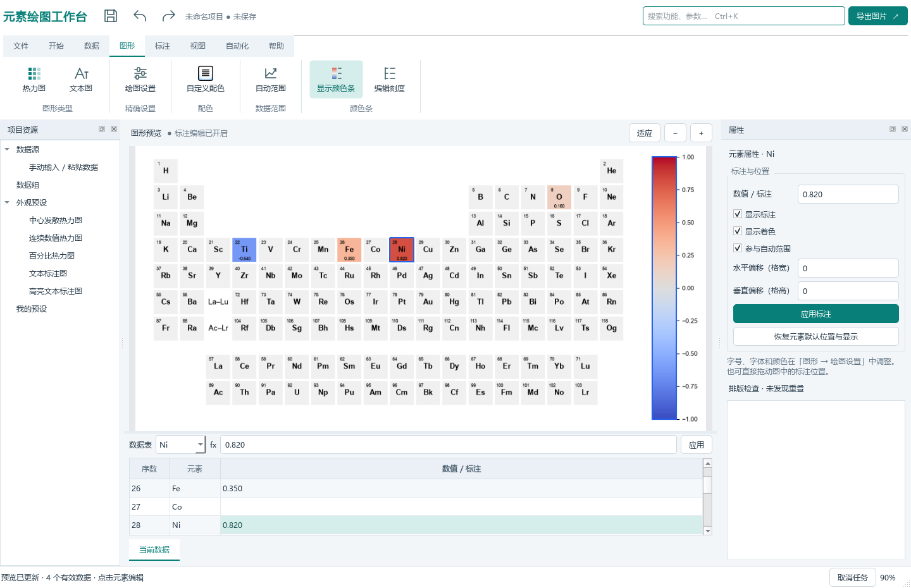

# Qt 绘图工作台：使用与扩展

2026-11-19，2.0 Alpha 1 预览版。Python 与独立 PlotSpec 绘图内核保留，默认桌面改为 PySide6 / Qt Widgets。稳定版保留 v1.9.0；本预览版用于体验新工作台并收集反馈。



上图由实际程序加载合成示例数据后绘制，非设计效果图；字体与画布均来自当前实现。

## 启动

```powershell
python -m pip install -r requirements.txt
python main.py
```

依赖使用 `PySide6-Essentials==6.12.0`，不需要浏览器内核或 Node 服务。迁移期可用 `python main.py --ui=tk` 返回上一版 schema 2 桌面；更老的 schema 1 桌面仅用于回归，入口为 `python -m ui.legacy_workbench`。Agent 请求仍在导入任何 GUI 模块之前处理。

## 功能在哪

| 功能区 | 用途 |
| --- | --- |
| 文件 | 新建、打开、保存、另存、输出设置、导出图片 |
| 开始 | 撤销/重做、示例、外观预设、保存预设 |
| 数据 | Excel/文本导入、粘贴、已导入数据组批量导出 |
| 图形 | 热力图/文本图、完整绘图设置、自定义配色、范围、色条与刻度 |
| 标注 | 开关交互编辑、恢复元素默认值、找回属性面板 |
| 视图 | 适应画布、实际像素、样图对照、布局、界面倍率 |
| 自动化 | Agent 接口说明、复制当前配置与数据的绘图请求 |
| 帮助 | 操作说明、日志开关/级别/临时详细记录、诊断包导出 |

Ctrl+K 打开统一命令搜索。所有按钮、快捷键和搜索结果指向同一 QAction，功能不会因入口不同而采用另一套逻辑。

左侧项目树展示数据源、数据组和预设；双击数据组切换，双击预设套用样式。中央预览与底部数据表由分隔条调整比例。右侧元素属性面板展示选中元素的标注、显隐、着色、范围参与和位置。面板可拖动、停靠、浮动与关闭，通过「恢复布局」找回；窄窗口可自动收起左侧资源树。

## 完成第一张图

1. 「开始 → 载入示例」，或「数据 → 导入数据」。Excel 向导选择工作表、元素/条件/数值区域和矩阵方向，后台预览通过后确认导入。
2. 双击数据表的数值列输入，Enter 提交。Ctrl+C 复制选区，Ctrl+V 粘贴；单格粘贴更新当前值，多行/多列打开可检查的导入框。
3. 底部工作表标签切换已导入的数据组，每组保留自己的编辑。当前表格显示活动组，不是完整 Excel 编辑器，不计算公式。
4. 「图形 → 绘图设置」分组设置颜色、归一化范围、字体、文本格式、画幅、DPI、背景与精确几何。画幅支持毫米/英寸，完整 PlotSpec JSON 编辑作为高级补充。
5. 点击图中的元素，在右侧编辑值与位置；左拖标注、右拖平移，滚轮缩放。标注编辑默认开启。色条可拖动，紧裁切情况下禁用色条坐标拖动；刻度通过「编辑刻度」直达色条设置页。
6. 「文件 → 输出设置」选择目录、文件基础名、SVG/PNG/PDF，点击右上角「导出图片」。每次自动添加时间戳，冲突时追加序号；不会覆盖已有图片。

表格非法值保留在单元格中并着色提示，提交前阻止保存/导出/切组。撤销可放弃尚未提交的无效输入。右侧属性和底部输入栏的待提交值也在保存前检查。数值形文本保留 `001`、`0.820` 等原始写法，热图仅在渲染边界转换数值。

项目保存、冲突检测、显式旧项目迁移、草稿恢复和预设沿用 WorkbenchSession；旧文件迁移时另存副本。Qt 与上一版 schema 2 工作台共用项目/预设/草稿，界面布局偏好独立存放在 `workbench-qt.json`。恢复旧模式配置变体的图形入口仍未提供，变体保留在项目中。

## 清晰度与成图质量

Qt 使用系统 DPI 的逻辑坐标布局，不调用旧 Tk 的全局 DPI 初始化。预览画布严格区分图片像素与界面坐标，缩放、点击命中、拖动使用同一变换。界面倍率不修改绘图字号或项目尺寸。

后台预览可接收独立的 `preview_max_pixels` 预算（400～3200，桌面使用1000～2400），放大窗口或更换高 DPI 屏幕后按需提高预览质量。正式导出仍采用项目 figsize 与 dpi；SVG/PDF 继续通过同一内核导出。交互选中框不写入最终文件。

## 模块边界

| 模块 | 职责 |
| --- | --- |
| `ui/qt/workbench.py` | 主窗口组装、命令绑定、应用会话调用、后台任务协调 |
| `ui/qt/commands.py` | CommandRegistry、功能区、命令搜索；共享 QAction |
| `ui/qt/data_table.py` | 表格模型、复制粘贴、无效草稿保留 |
| `ui/qt/inspector.py` | 元素上下文属性与排版提示 |
| `ui/qt/settings.py` | 完整 PlotSpec 参数表单、颜色节点、刻度表、高级配置 |
| `ui/qt/preview.py` | 只接收像素包的画布，DPI、选择、拖动、平移 |
| `ui/qt/excel_dialog.py` | 异步只读预览，过时结果失效，导入确认 |
| `ui/qt/theme.py` / `icons.py` | 统一视觉规范和多倍率矢量图标 |
| `ui/qt/smoke.py` | 隔离用户目录的真实预览与三格式导出验收 |
| `application/workbench_session.py` | 项目状态、事务、历史、数据组与持久化，无 Qt 依赖 |

新增菜单功能：注册稳定 command id、中文标题、功能区/分组、快捷键和搜索关键词，再绑定应用服务。不要复制一份绘图业务到按钮槽函数中。新增绘图参数：先扩展 PlotSpec 和渲染服务，再接表单；新默认链路不得导入 Tk、旧 STYLES 或 corrected_style。

## 验证与尚待完成的工作

```powershell
python -m pytest tests/test_qt_settings.py tests/test_qt_preview.py tests/test_qt_excel_dialog.py tests/test_qt_workbench.py tests/test_qt_commands_data.py tests/test_qt_edit_transactions.py tests/test_desktop_entry_v2.py tests/test_render_jobs_v2.py
```

Qt 测试在独立的 offscreen 子进程中运行，避免与迁移期 Tk 测试相互影响。画布测试覆盖1倍/2倍DPR、NumPy坐标、失效预览和拖动；集成测试实际启动渲染进程并检查 SVG/PNG/PDF 文件。

源码验收：`PTT_SMOKE=1`、`PTT_SMOKE_EXPORT_DIR` 指定输出目录，运行 `python main.py`；可用 `PTT_SMOKE_MARKER` 指定标记文件。冻结版使用 `build_exe.py` 与 `verify_exe.py`。本机锁屏期间生成的应用截图属于真实 Qt 离屏绘制，不代表已完成可见桌面鼠标操作验收。原生桌面多屏切换、安装包验收和正式发行需分别记录，不能由效果图或单元测试代替。
