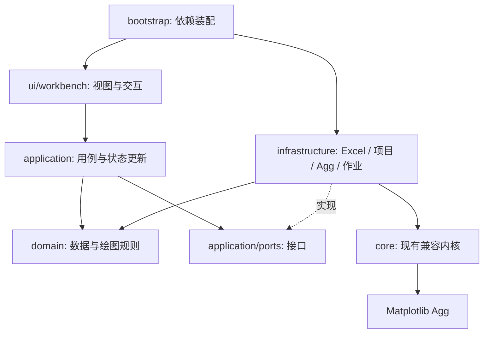

# 架构、数据契约与迁移

本文描述目标设计，路径除“现有接口”外均为计划新增。接口签名是契约草案，A00冻结后才开始并行实现；变更必须同步调用方、序列化和测试。

## 1. 分层与依赖

采用模块化单体和端口/适配器。业务域仅依赖Python标准库；应用层编排事务；基础设施实现文件读取、绘图、进程和持久化；UI只调用应用服务。所有依赖在启动入口显式注入，不使用全局服务定位器。



禁止：domain导入Tk/Matplotlib/openpyxl；UI直接读写Excel和项目JSON；渲染器访问Tk变量；进程载荷携带Figure、文件句柄、工作簿或控件；绘图线程调用Tk；持久化保存可执行对象。

建议目录（每个包显式包含`__init__.py`，更新setuptools打包白名单）：

```text
main.py                         # 保留启动兼容，最终仅转发bootstrap
bootstrap.py                    # Agg/freeze_support/装配/启动
domain/
  data.py                       # 来源、单元格、指标、条件、数据组、覆盖
  mapping.py                    # 映射、转换、关联规则
  plot.py                       # 图形绑定、颜色、标注、画布
  project.py                    # 项目聚合与不变量
  diagnostics.py                # 结构化问题
  normalization.py              # 范围和归一化纯函数
application/
  ports.py                      # 所有跨层接口唯一声明处
  commands.py                   # 用户命令、撤销边界
  state.py                      # Store、事务、revision
  import_service.py             # 检查/候选/转换/提交
  refresh_service.py            # 三方合并与来源更新
  plot_service.py               # 生成不可变渲染计划
  export_service.py             # 批量计划/执行/发布
  project_service.py            # 项目/草稿/迁移用例
  preset_service.py             # 预设应用范围
infrastructure/
  readers/{xlsx,delimited,legacy}.py
  persistence/{project_json,migrations,presets,settings}.py
  rendering/{legacy_adapter,agg_renderer,geometry}.py
  jobs/{scheduler,protocol,worker}.py
  export/{publisher,manifest,naming}.py
  diagnostics/{logging,environment}.py
ui/
  workbench/{shell,controller,data_panel,inspector,status}.py
  import_wizard/{dialog,grid,mapping,diagnostics}.py
  editors/{colorbar,bindings,annotations,presets}.py
  preview.py                    # 复用，逐步增加编辑overlay
core/                           # 原接口保持直到迁移完成
tests/{domain,application,integration,ui,acceptance}/
```

不得为了目录整齐立即搬空core；先新增适配层，让旧界面和新界面复用同一经过验证的渲染器。

## 2. 数据域契约

所有ID为稳定、不含业务含义的字符串；显示名称可修改，ID不变。内存可使用dataclass，跨进程及项目边界只允许明确版本的JSON兼容DTO。数值仅允许有限float/int；文本和原始字面串独立保存，不能用float往返恢复文字。

### 2.1 类型表

| 类型 | 必需字段 | 不变量与用途 |
|---|---|---|
| SourceRef | id, kind, display_name, locator, fingerprint | locator可空；fingerprint含sha256/size/mtime，不把mtime当内容相同证据 |
| CellRef | source_id, sheet, address | address为单个A1坐标；只能用于可定位的来源 |
| CellValue | kind, raw_text?, numeric?, formula?, cached?, format_code?, source? | kind=number/text/missing/error；公式是来源属性，不是执行指令 |
| Metric | id, name, unit?, value_kind | value_kind=numeric/text/category；unit未知时为null |
| Condition | id, label, attributes | attributes存比例/温度等有类型值、单位、显示文本；不以标签做唯一键 |
| Dataset | id, metric_id, condition_id, records, provenance | 同组每元素一条；records按元素符号索引 |
| ElementRecord | element, value, attributes | value为CellValue；attributes为稳定字段ID到CellValue映射 |
| ImportMapping | id, source_id, schema_version, layout, regions, policies, transforms | 映射无UI坐标；区域用工作表名+A1范围 |
| Override | dataset_id, element, field, value, base_value | 手工修改独立于源快照；记录覆盖前的源值 |
| Diagnostic | code, severity, message, locations, target?, remedy? | severity=info/warning/error；code稳定、文案可本地化 |

Dataset.provenance记录mapping_id、来源快照hash、转换版本和创建时间。records中的missing必须保留到领域层；仅在legacy适配层可为旧接口略去空值。有效元素固定来自内置元素表，不在线查询。

### 2.2 映射结构

layout枚举：`matrix_rows`、`matrix_columns`、`records`、`category_groups`。

```json
{
  "schema_version": 1,
  "id": "map-distortion",
  "source_id": "src-example",
  "layout": "matrix_rows",
  "regions": {
    "elements": {"sheet": "Distortion", "range": "B1:AG1"},
    "conditions": {"sheet": "Distortion", "range": "A2:A6"},
    "values": {"sheet": "Distortion", "range": "B2:AG6"}
  },
  "metric": {"name": "Distortion", "unit": null, "value_kind": "numeric"},
  "condition": {"name": "比例", "unit": "%", "interpretation": "percent_points"},
  "policies": {"duplicate": "error", "missing": "keep", "hidden": "include", "formula": "cached_only"},
  "transforms": []
}
```

必须验证矩阵宽度与元素数量、矩阵高度与条件数量一致。records映射使用字段列和数据起止行；category_groups使用类别列、元素范围及可选分组名。每个layout独立校验器，不能靠位置猜测填补错误。

转换仅支持白名单声明式步骤：trim、显式大小写规范化、numeric_parse、percent_scale、round、显式重复聚合。保存参数与顺序，不允许eval或任意表达式。自动检测仅返回候选和理由，不提交转换。

关联JoinSpec：left_dataset_id/right_dataset_id或属性源ID、key=`element`、field_map、unmatched=`keep_missing`、duplicate=`error`。按元素符号关联，不按Excel列号；左侧绘图元素保留，右侧多余元素报告数量，缺失属性标为空，不删除数值记录。

### 2.3 Excel读取

Reader首先提供SheetSummary(name, physical_bounds, nonempty_candidates, hidden_state)，再按范围读取。扫描默认限制前200行×200列用于候选发现，可手工定位更大范围；不能因为候选扫描截断而声称整表无数据。

XlsxReader以公式视图和data_only视图配对读取同一文件快照，避免两次读取之间文件变动；配对后校验hash。若源文件正在保存导致不一致，提示重试，不混合两个版本。文件句柄在作业结束必定关闭。

首次读取可复制到应用临时目录作为稳定快照；原文件只读。检测压缩包解压大小/条目数/选区单元格预算并返回诊断，阈值可配置；建议初始上限50MB文件、500MB累计解压、100万选区单元格。超限允许选择更小范围，不在UI线程扫描。

Excel日期/布尔值默认不作为热图数值；用户显式转换才可用。公式缓存存在不证明最新，只显示“使用工作簿已保存结果”。支持共享公式由读取库解析，不自行实现Excel公式引擎。

## 3. 图形域契约

PlotSpec字段：id、name、style_id、style_version、compatibility、dataset_id、bindings、color、labels、layout、canvas、element_overrides。compatibility=`scientific`或`legacy`。legacy使用现有style_id，不通过中文显示名识别样式。

| 子配置 | 字段和规则 |
|---|---|
| BindingSpec | fill/primary_label/secondary_labels/border分别指定field_id；fill为continuous或categorical之一 |
| RangeSpec | mode=auto_dataset/auto_selection/manual/source_cells，min/max，selection_ids，source_bindings，snapshot |
| NormSpec | kind=linear/two_slope；center仅two_slope使用；必须min<center<max |
| PaletteSpec | continuous节点position∈[0,1]严格递增；categorical为category→color映射 |
| ColorbarSpec | visible、orientation、placement、length_fraction、width_fraction、pad、title、ticks |
| TickSpec | id、value、label、visible、source_binding?；隐藏仍保留值和文字 |
| LabelSpec | field、format、precision、unit、font_family、font_size_pt、wrap、offset_cell |
| CanvasSpec | width_in、height_in、export_dpi、background、transparent、crop=fixed/legacy_tight |
| ElementOverride | 元素级颜色/边框/标注偏移/可见性；明确作用于本图或整个样式 |

手工属性覆盖优先于绑定的默认样式，但不修改数据本身。修改数据和修改显示为不同命令。类别“隐藏”仅影响该通道是否绘制，不自动从数值范围统计中排除；如要排除记录，使用显式数据筛选。

色标数值必须有限；重复数值拒绝，文字可重复。排序只调整显示编辑列表，不改变value。超范围tick保留并警告，可选择修正/隐藏/继续；颜色条隐藏时仍校验配置完整性，以便恢复显示。

StyleDescriptor含id/version/name/thumbnail/data_kinds/layouts/capabilities/defaults/legacy_origin。注册表根据capabilities控制UI；不支持某设置时显示原因并保留用户值，不能静默丢弃。科学模式与legacy模式各自保存配置，切换模式不重新转换数据。

## 4. 应用服务端口

以下为Python形状示意，类型在domain定义；异步作业由调度层实现，不把Future暴露给Tk视图。

```python
class WorkbookReader(Protocol):
    def inspect(self, source: SourceRef, cancel: CancelToken) -> WorkbookSummary: ...
    def read_region(self, source: SourceRef, region: Region, cancel: CancelToken) -> CellGrid: ...

class ImportService(Protocol):
    def propose(self, summary: WorkbookSummary, grids: list[CellGrid]) -> list[MappingCandidate]: ...
    def preview(self, mapping: ImportMapping, grids: list[CellGrid]) -> ImportPreview: ...
    def commit(self, preview_id: str, expected_revision: int, mode: ImportCommitMode) -> CommandResult: ...

class PlotCompiler(Protocol):
    def compile(self, project: ProjectSnapshot, plot_id: str, dataset_id: str) -> RenderPlan: ...

class Renderer(Protocol):
    def render(self, plan: RenderPlan, target: RenderTarget, cancel: CancelToken) -> RenderArtifact: ...

class ProjectRepository(Protocol):
    def load(self, path: Path) -> LoadResult: ...
    def save(self, path: Path, snapshot: ProjectSnapshot) -> SaveResult: ...

class ExportService(Protocol):
    def plan(self, snapshot: ProjectSnapshot, selection: ExportSelection) -> ExportPlan: ...
    def start(self, plan: ExportPlan) -> JobHandle: ...
    def cancel(self, job_id: str) -> None: ...
```

ImportPreview必须含不可变候选数据、mapping_hash、source_hash、diagnostics和统计；只有未解决error=0才允许commit。preview_id在来源/映射改变后失效。Service不调用messagebox；返回CommandResult(applied, revision, diagnostics)。

ReaderRegistry按扩展名与签名选择适配器；StyleRegistry按稳定ID选择；ExporterRegistry声明格式及能力。第三方扩展暂仅开发者编译期注册，避免未经验证模块进入发行包。

## 5. 状态、撤销与事件

AppState拆分：ProjectState（持久化业务数据）、SessionState（列表高亮/编辑模式/临时输入）、ViewState（布局、缩放、面板）、JobState（进度、错误）。唯一Store持有状态；视图从selector获取投影。

**数据组唯一真值**：活动PlotSpec.dataset_id是当前预览和单张导出的唯一数据组。用户在数据组列表执行“切换绘图数据”时发送SetActiveDataset命令，更新该字段、产生一次撤销和dirty；仅列表多选/高亮不改变它。状态栏明确显示正在绘图的组名。保存重开恢复该字段。compile的dataset_id参数仅用于批量计划的显式覆盖；预览与单张导出调用时必须等于PlotSpec.dataset_id，不同则拒绝。批量覆盖不写回项目。SessionState不再另存一个可供渲染使用的selected_dataset_id。

命令示例：ImportDatasets、EditValue、SetPlotBinding、SetColorRange、UpsertTick、MoveAnnotations、ApplyPreset、RefreshSource、ReplaceProject。执行顺序：解析→校验→创建新状态→事务提交→revision+1→发通知→安排预览/草稿。失败必须保持原状态。

事件：ProjectChanged(revision, changed_paths)、SelectionChanged、ImportPreviewReady、RenderReady、JobProgress、JobFailed、ExportItemPublished。事件仅用于通知，不作为第二份状态仓库，不采用事件溯源持久化。

编辑框允许暂存无效字符串，但不进入ProjectState；显示错误并禁用依赖该项的应用按钮。输入防抖建议250ms；连续输入一个字段合并撤销记录，焦点切换或确认结束合并。拖动期间overlay实时更新，鼠标释放只提交一次。

历史初期继续复用快照方式，建议限制100步和64MB累计预算，超限淘汰最旧项并保留当前状态；大项目后续可换命令补丁，不改变外部History接口。dirty依据当前内容hash与保存内容hash比较，撤销回保存点应变为干净。

## 6. 渲染、坐标与并发

RenderPlan是完整、不可变、可序列化的绘图输入，含protocol_version、request_id、project_revision、data_hash、style_hash、renderer_version和已解析数据/样式。导出时不从UI读取任何额外参数。

渲染流程：解析绑定→数据校验→解析范围/刻度→布局与标注→Agg绘图→预览栅格或文件输出。预览和导出使用同一RenderPlan与布局，只有raster DPI不同。固定画幅保持物理尺寸；legacy_tight复用现有裁切规则。

命中区域与图片一起返回：坐标链为元素格局部→绘图物理坐标→裁切后的预览像素→画布缩放/平移→屏幕。返回crop_offset、image_size和元素/标注hit_regions；点击使用逆变换，拖动结果转为offset_cell保存。不能从屏幕坐标直接推算导出偏移。

进程消息协议：`{protocol:1, job_id, request_id, revision, kind, payload}`；kind为started/progress/preview_ready/item_staged/done/error/cancelled。错误含稳定code和可显示message，堆栈仅日志。

调度规则必须区分：

- 预览通道latest-wins，只合并预览，丢弃revision/hash不匹配的返回；旧图显示“正在更新”。
- 导出通道FIFO，明确排队和取消，不得被新预览覆盖。每批冻结snapshot；串行渲染以控制内存。
- 初期可共享一个worker，导出执行时预览排队并显示状态；如果验收要求导出中继续实时预览，则增加独立预览worker，并限定最多两个绘图进程。
- Excel扫描在独立I/O作业执行，通过主线程after轮询队列刷新UI；取消token每个读取块检查。
- worker崩溃使当前任务失败，释放资源，可重启后重试；不无限自动重试。

**暂存所有权**：导出暂存目录属于ExportService，不属于下一次预览请求。worker返回item_staged后由publisher持有，只有发布完成/取消清理后释放。过渡适配现有RenderJob时，必须在下一次start/cancel前将产物接管到导出专属目录；增加回归测试证明不失效。IPC内部可以暂时保留pickle，但任何项目、Excel、预设或外部文件禁止使用pickle反序列化。

发布单文件使用同卷临时文件＋平台不覆盖的提交策略；文件名预留必须排他，发布失败清理自己创建的临时/占位文件，不删除用户已有文件。批次manifest逐项原子更新；取消只清理该job_id目录。不得声称多个文件全局原子。

**发布恢复协议**：每项状态为queued→rendering→staged→publishing→completed，另有failed/cancelled/published_unrecorded/recovery_required。发布前，在用户数据目录的job journal持久化item_id、最终目标路径、暂存hash和size，并flush；写journal失败则不能发布。发布图片成功后更新journal，再更新输出目录manifest。图片成功而记录更新失败时，内存状态为published_unrecorded，显示“图片已生成，记录未完成”，不能报告普通failed并直接重新绘图。下次启动或重试先读取journal，对publishing/published_unrecorded项核对目标hash/size：匹配则补写completed和manifest；目标不存在才重新排队；目标存在但不匹配为recovery_required，保留文件并交用户决定新文件名。崩溃在图片提交与journal更新之间同样按此核对。manifest是journal的可恢复投影；用户删除journal后不保证自动恢复，但仍绝不覆盖已有图片。增加这三个提交窗口的故障注入测试。

## 7. 持久化与迁移

继续`.ptproj` JSON，schema从1迁移到2，顶层结构：

```json
{
  "schema": 2,
  "app_version": "implementation-version",
  "project_id": "uuid",
  "created_at": "UTC ISO-8601",
  "sources": [],
  "mappings": [],
  "metrics": [],
  "conditions": [],
  "datasets": [],
  "overrides": [],
  "plots": [],
  "active_plot_id": null,
  "legacy_style_states": {},
  "extensions": {}
}
```

完整schema必须由A00提供JSON Schema和golden fixtures，验证必填字段、枚举、数值范围、唯一ID和引用完整性；不用此示例替代完整schema。schema版本未知时拒绝编辑，保留原文件，显示需要升级。扩展字段仅位于命名空间extensions中并往返保留，核心字段拼写错误不能默默忽略。

迁移`v1→v2`为纯函数：将current.data变成一个数据组，将current模式/params/display映射为PlotSpec；styles中各自的数据和设置完整保存在legacy_style_states，按需导入为独立图形状态，不错误合并。保留原compatibility和旧样式ID。迁移打开不自动覆写文件，首次保存提供另存提示并在覆盖前保留迁移备份。

旧状态使用独立入口“导入旧项目中的样式工作状态”：选择style_id后，一次性创建独立Dataset与PlotSpec，以project_id+style_id生成确定性ID，记录materialized_plot_id/materialized_dataset_id。再打开该入口只定位到已创建对象，不重放原始载荷。若用户要重新恢复原始状态，必须使用明确的“另存恢复副本”，生成新ID。普通样式切换只换设置，永远不加载legacy_style_states的数据；保存重开保留物化索引和编辑后的对象，不能再次覆盖。原始载荷留作迁移备份，不再作为活动对象的第二份状态。

项目、预设、导入方案分别有schema版本，不共用一个大JSON载荷。设置位于用户目录；布局属于settings，不把屏幕分辨率写成绘图属性。项目来源优先相对项目目录保存定位信息，找不到可重新链接；快照足以离线作图。

保存过程：验证→编码allow_nan=False→同目录唯一临时文件→flush/fsync→replace；失败保留旧文件。加载过程：读取/迁移/校验所有对象→构建新状态→一次替换，不能先清空旧界面。

自动草稿按project_id区分，记录revision和正式路径；去抖保存且有单写入队列，防止旧revision最后覆盖新草稿。恢复由用户选择，不能把上次的独立项目草稿覆盖当前项目。

### 7.1 规范化数据导出

DataExportService归A04，基础设施写入器位于infrastructure/export/data_writer.py；与A08的图片publisher目录分文件所有权。CSV/XLSX均采用长表，固定字段：dataset_id、metric、unit、condition_id、condition_label、element、field_id、value_kind、numeric_value、text_value、display_text、is_missing、is_override、source_sheet、source_cell。每个元素的主值和附加属性各一行；不以宽表列顺序关联。

默认导出effective值（源快照叠加用户覆盖），用户可选source_snapshot；导出文件附说明列/元数据注明选项。numeric_value保存未按显示精度舍入的有限数字；text_value独立保留001等原文，display_text仅供显示，missing的数值和文本均留空并置is_missing=true。XLSX文字单元格强制字符串类型，不执行以等号开头的用户标注；CSV正确引用分隔符/换行，并提供“电子表格安全显示”转义选项，开启时记录转义规则，关闭时提示用文本列导入以保留字面值。源绝对路径默认不导出。导出不得修改项目或来源文件，采用单文件不覆盖发布；xlsx写入依赖与读取依赖统一由A11管理。

## 8. 可扩展性与可观测性

新增读取器只实现WorkbookReader或TabularReader并注册；新增样式提供descriptor和渲染能力；新增导出格式实现exporter能力声明与验证；新增属性字段通过FieldDescriptor描述类型、显示名和兼容通道，不修改每个UI分支。

日志以[排错日志与开关](05-diagnostics.md)为准：总开关、级别、临时排错、单writer队列、结构化事件、脱敏和故障降级。默认单文件2MB、总容量20MB、保留7天。导出恢复journal不受日志开关影响。

渲染缓存键包含完整数据/样式/标注/字体签名、尺寸、兼容模式和渲染版本；不得仅用文件路径作缓存键。首轮可不启用磁盘缓存，保证正确性后再优化。

## 9. 架构决策记录

| ADR | 决策 | 原因与代价 | 重新评估条件 |
|---|---|---|---|
| 001 | 保留Tk与Agg | 复用现有EXE、测试、绘图质量；复杂表格需自建虚拟窗口 | 大数据表和可访问性目标经实测无法满足 |
| 002 | 模块化单体 | 本地任务无需服务运维；通过接口保持可替换性 | 有明确多用户远程协作需求 |
| 003 | Excel只读缓存 | 无Excel依赖、语义可追踪；不能计算未缓存公式 | 用户明确需要公式计算并接受独立引擎验证 |
| 004 | 项目嵌入数据快照 | 源文件丢失仍可重现；文件体积增大 | 实测大项目超出JSON性能预算 |
| 005 | 历史兼容独立适配 | 保留原图回归；维护两套行为 | 用户明确取消历史兼容要求 |
| 006 | 任务分通道 | 防止预览覆盖导出；调度复杂度略增 | 不得因简化实现取消该不变量 |
| 007 | 批次显式部分成功 | 符合多文件发布实际语义；需manifest和重试 | 未来改为单一ZIP整体交付时另设模式 |

未经测量不引入缓存服务、数据库、消息总线或多个GUI框架。接口扩展以实际工作包需求为界，避免提前设计无用户场景的插件平台。
