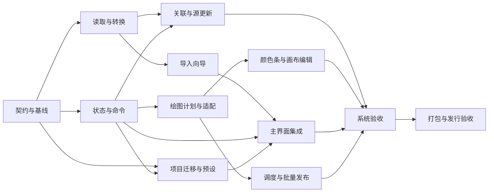

# 子代理实施任务书

## 1. 协作组织

统筹/架构负责人采用Astra，负责契约冻结、复杂状态与并发、集成、风险取舍和最终验收；Sol负责有清晰边界的模块实现与测试。模型安排是本项目的工作分工建议，实际调用以会话可用模型为准，不因模型名称替代代码审查。

主代理保留关键路径：冻结接口、维护共享入口、集成与冲突处理。子代理负责独立工作包，提交代码、测试和已知限制。只读审查和最终验证可并行，但不能让两个代理重复实现同一模块。

每个工作包开工前须记录：负责人、工作分支或worktree、基线提交、依赖交付版本、允许写入路径、禁止写入路径、验收命令。只读访问全仓库允许；写入必须在分配范围。不同worktree仍不允许并行决定同一个公共契约。

## 2. 文件所有权

| 范围 | 唯一负责人 | 规则 |
|---|---|---|
| domain/*、application/ports.py、schemas/* | Astra/A00 | 契约变更经统筹合并后通知所有消费方 |
| main.py、bootstrap.py、application/state.py、commands.py | Astra/A03/A07 | 子代理只提供接入补丁建议，不自行改共享入口 |
| infrastructure/readers/*、application/import_service.py | Sol/A01 | 不改UI与绘图核心 |
| ui/import_wizard/* | Sol/A02 | 用mock服务开发，不改导入语义 |
| application/refresh_service.py、绑定解析 | Sol/A04 | 新增绑定文件路径先由A00确认 |
| application/data_export_service.py、infrastructure/export/data_writer.py | Sol/A04 | 仅规范化数据导出，禁止改A08图片发布器 |
| infrastructure/rendering/*、颜色域服务 | Astra/A05 | core/styles.py改动须单独审查历史一致性 |
| ui/editors/*、ui/preview.py | Sol/A06 | 与A07约定事件接口；不拥有项目状态 |
| infrastructure/jobs/*、application/export_service.py、infrastructure/export/*（排除data_writer.py） | Astra/A08 | 临时文件和图片发布职责不得跨代理拆开实现 |
| infrastructure/persistence/*、project/preset services | Sol/A09 | 迁移契约由A00持有 |
| build_exe.py、make_dist.py、依赖文件、spec、verify_exe.py | Sol/A11 | 打包白名单和依赖版本集中管理 |
| tests/acceptance/*、合成fixtures | Sol/A10 | 功能模块自己的单元测试由模块作者写 |
| infrastructure/diagnostics/*、ui/diagnostics/*、日志专用测试 | Sol/A12 | bootstrap由A07接入，公共端口由A00持有 |

若同一负责人接多个包，按依赖顺序执行。不要同时运行两个修改ui/preview.py或core/jobs.py的代理。

## 3. 里程碑与依赖图

日期、资源容量与分阶段交接以[主管排期](06-schedule.md)为准；接口前置未完成时只允许契约mock，不视为完成真实集成。



- M0：A00通过，现有软件可运行，契约和回归基线冻结。
- M1：A01/A02/A03/A05基础/A06基础/A07基础/A08基础/A09基础串联，Excel→一组预览→单张导出→项目重开可用。A06基础允许复用现有颜色条控件但必须接入新状态；A08基础必须包含单张导出的独立暂存和防覆盖发布。尚未完成能力在UI隐藏或标明，不伪造入口。
- M2：A04/A06/A08/A09完整，样例15组、分类关联、色条绑定、更新冲突、批量导出通过。
- M3：A10/A11，全部P0/P1验收、文档更新、EXE与源码包可交付。

各包使用契约mock可提前开展UI结构，但只有依赖的真实接口通过契约测试后才允许合并“完成”。不要把“mock演示成功”当成M1交付。

## 4. 工作包细则

### A00 — 契约冻结与回归基线（Astra，最先执行）

输入：全部设计文档、现有v1.6.0代码和测试。输出：domain类型、ports、schema2完整JSON Schema、schema1/2与预设/映射golden fixtures、错误码清单、StyleDescriptor清单。

任务：记录当前测试与环境；确认14个style_id及capabilities；定义所有DTO的optional/default语义；确认unknown-field策略；建立合成工作簿生成器需求；确认legacy和scientific范围。

验收：schema示例均验证通过；非法引用、非有限数、重复ID被拒绝；DTO往返无损；domain不依赖Tk/绘图库；旧功能基线结果可复核。不得开始改绘图数学。

### A01 — Excel与文本导入核心（Sol）

依赖A00。实现XlsxReader、旧文本读取适配、四类映射转换、候选发现、诊断和ImportPreview；冻结同一次读取的源快照。候选扫描与手动读取分离；读完关闭文件。

测试：横纵等价；无表头；空值/零；32元素×5组；公式缓存/缺缓存；重复/未知元素；百分比单位；隐藏行；合并数据区；损坏文件；范围越界；取消。公共fixtures为合成数据。

验收：样例前三表转换为15组、480值且不包含ROUND辅助区；给出每个值的CellRef；出错不返回“成功空表”。不写Excel、不读Tk控件。

### A02 — 图形化导入向导（Sol）

依赖A00，基于mock可先开发；合并依赖A01。实现工作表选择、表格窗口、范围输入/框选、方向切换、字段映射、诊断定位、导入预览和提交。

验收：800×600可操作；取消不改变项目；改映射使旧preview_id失效；错误阻止提交、警告可继续；用户无需编辑Excel完成横向样例导入；大表不一次创建百万控件。UI测试只断言行为，不绑定无意义像素位置。

### A03 — 状态与事务（Astra）

依赖A00。实现Store、CommandResult、revision、dirty、撤销合并、视图selector、保存点和项目替换事务；暂不移动所有旧UI。

验收：失败命令不改变状态；同一事务仅一次revision和一次历史；拖动撤销一次恢复；撤销到保存点清除dirty；旧项目加载失败保留正在编辑内容；多数据组切换不丢样式或覆盖值。

### A04 — 绑定、类别与来源更新（Sol）

依赖A00/A01/A03。实现按元素Join、属性FieldDescriptor、类别分组展开、三方刷新、导入方案管理。加入源结构变化检查与重新映射入口的数据支持。实现架构§7.1规范化CSV/XLSX数据导出，选择effective/source_snapshot并保留类型与精度；对应DAT-T04验收。

验收：元素列重新排序仍正确关联；缺失属性不丢数值；重复关联产生诊断；手动改值和新源同时变化时冲突；仅源变化自动更新；仅手动变化保留；源删除有明确保留/删除选择；整次刷新可撤销。

### A05 — 绘图计划与兼容适配（Astra）

依赖A00/A03。实现PlotCompiler、LegacyRendererAdapter、科学渲染通道、统一归一化、类别图例、数据/显示精度分离、几何与命中协议。

验收：13种legacy原图对照不退化；scientific保留零；同RenderPlan预览/输出布局一致；类别顺序稳定；色条文字不改变颜色；数据值不被显示精度修改；空数据/常量/中心边界明确处理。不得通过扩大测试容差掩盖图形变化。

### A06 — 色条、预设设置与画布编辑（Sol）

依赖A00/A05/A03，预设服务依赖A09。实现tick CRUD、来源绑定选择器、颜色节点、主/辅标注、直接拖动、多选对齐、单项恢复与基础/专业设置。

验收：刻度隐藏/恢复无丢失；删除最后一条后仍可新增；重复和非有限值定位错误；缩放/平移/裁切后点击正确；拖动距离跨DPI保持物理一致；overlay不导出；Esc取消不生成历史；同通道冲突不可静默覆盖。

### A07 — 新工作台与渐进集成（Astra）

依赖A02/A03/A05/A06基础/A08基础/A09基础。抽取main.py入口到bootstrap，构建shell/controller和数据组树/检查器/状态栏，接入真实服务。M1必须消费A08的真实预览与单图导出接口，不可自行复制调度或文件发布实现。

验收：主入口仍可`python main.py`启动；freeze_support保留；窗口布局自动/手动可切换并持久化；800×600与高DPI可操作；关闭/打开/新建均处理未保存状态；键盘保存撤销和导出可用。旧接口只在适配层存在，UI不得复制一套业务校验。

### A08 — 作业调度、批量与安全发布（Astra）

依赖A00/A05/A03。实现预览latest-wins、导出FIFO、数据快照、独立暂存所有权、取消和worker重启；批量规划、同指标色标、命名、manifest、失败重试。

验收：连续20次预览只显示最新；预览不覆盖排队导出；导出中改数据不改变已冻结批次；在读取/渲染/发布阶段取消均可恢复；同名文件不覆盖；磁盘写入失败后manifest准确，用户原文件不删除；下一次预览不能删除待发布图片。

### A09 — 项目、预设与迁移（Sol）

依赖A00/A03接口。实现schema1→2、原子加载保存、分项目草稿、源重新链接、预设与导入方案CRUD。旧预设数据默认不覆盖当前数据，明确应用范围。

验收：schema1的current/styles完整保留；未知未来schema拒绝且不改原文件；损坏数据加载原子；保存断电模拟保留前版本；项目无Excel源仍能渲染；草稿不串项目；预设复制编辑不改变内置条目；非法路径名拒绝。

### A10 — 系统验收与真实任务验证（Sol独立验证）

依赖M1起持续编写验收，M2完成执行全套。维护需求ID→测试ID矩阵、合成fixtures、真实样例本地验收脚本和质量报告。

验收：按04文档输出pass/fail/not-run，不用总测试数量替代功能覆盖；至少执行15张样例图和分类叠加；截图验证关键UI状态，实查PNG/SVG/PDF；报告遗留问题及严重度。不得修改功能代码来绕过失败断言，交由模块负责人修复。

### A11 — 依赖、打包与发行准备（Sol）

依赖A00可提前检查依赖，最终依赖A10。集中更新pyproject/requirements/build_exe固定依赖、包白名单、make_dist示例及docs白名单、verify_exe实际Excel链路。当前源码声明Python>=3.9，EXE构建固定Windows CPython 3.14.2 x64；不要擅自升级Python目标。新语法/API必须符合声明的最低版本，若需提升最低版本，先提交ADR与迁移影响，由统筹决定。

验收：冻结依赖可构建；源码wheel可导入新包；EXE离线、无Python、非管理员、中文路径可绘图；发布目录含EXE、Windows ZIP、源码ZIP、SHA256SUMS和发布说明；文档版本一致；归档不含用户Excel、个人项目、缓存和日志。上传发行版仅在明确要求发布时执行。

### A12 — 日志、开关与诊断包（Sol，Astra审查并发与错误边界）

依赖A00，与A01/A03并行启动。按05-diagnostics实现DiagnosticService、单writer、worker日志协议、实时开关、临时排错、查看器、轮转清理与诊断ZIP。A07接入bootstrap/菜单/Tk异常，A08接入worker错误与trace，A11验证EXE冷启动；A12不越权修改这些共享文件。

M1增加A12基础依赖，通过LOG-T01/T03/T05/T06/T08；M2完成其余LOG测试；M3纳入EXE验收。不得将关闭日志等同于关闭恢复journal。

## 5. 子代理派发模板

```text
任务：Axx — 标题
基线提交：<sha>；契约版本：<sha/version>
先读：docs/workbench/README.md及相关契约/验收章节。
目标：<一项可演示的完整行为>
允许写入：<明确目录与文件>
禁止写入：main.py、公共契约、依赖文件等未分配路径。
输入/输出接口：<类型和版本>
必须通过：<场景与命令>
要求：直接实现并写相关测试；不得提交用户数据或扩大范围；遇到接口缺口向统筹报告。
交付：改动文件、接口变动、验证命令及结果、限制、集成注意事项、提交SHA。
```

## 6. 集成与完成定义

1. 统筹确认工作树和依赖基线；代理提交范围内改动。
2. 审查是否越界、是否修改公共契约、是否改变原图语义。
3. 运行模块测试与消费者契约测试；新故障先修复，不跳过。
4. 合入后执行一条真实用例：导入→预览→导出或该包对应完整流程。
5. 更新任务状态：planned/in_progress/blocked/review/accepted，记录证据。blocked必须具体到依赖或问题，不能笼统写“待优化”。

完成必须同时有实现、错误路径、验证证据和用户可理解反馈。只有文档、stub、静态截图或成功启动窗口均不等于功能完成。

严重度：S0数据丢失/覆盖用户文件/执行不可信输入；S1错误着色、数据映射错误、主流程无法完成；S2局部功能失败或可恢复异常；S3文案/非关键视觉。S0/S1必须修复后进入下一里程碑，P0/P1对应S2不能留到发行后。

## 7. 当前执行状态

本文件创建时A00—A12均为planned。已完成的是设计与只读现状/架构审查，不是实现或测试。实施时用独立状态表记录负责人、提交和证据，不能把设计中的预期结果写成实测结果。
